<div align="center">

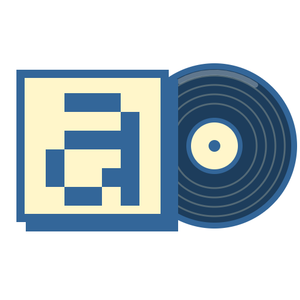

# abyss

**A fast, ad-free YouTube Music player for your desktop.**<br>
Synced lyrics with romaji · 7 themes · 10 fonts · Discord status · offline downloads · your own library

[](https://github.com/yumekuse/Abyss-Music/releases/latest)
[](https://github.com/yumekuse/Abyss-Music/releases)
[](https://github.com/yumekuse/Abyss-Music/actions/workflows/build.yml)

[](LICENSE)

[**⬇ Download**](https://github.com/yumekuse/Abyss-Music/releases/latest) · [Features](#features) · [Install](#install) · [Screenshots](#screenshots) · [FAQ](#faq)

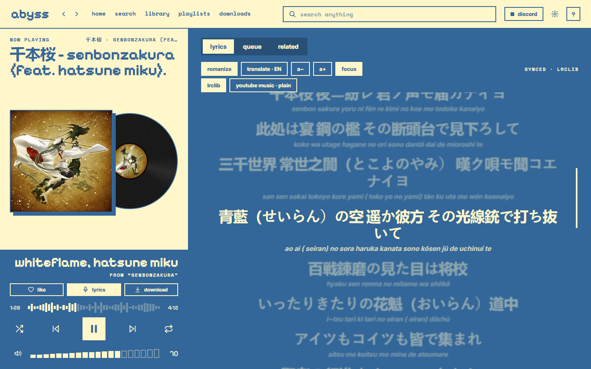

</div>

---

## Why abyss?

- **Instant.** A single ~6 MB app written in Rust. The window is up in about **0.35 s** and home is filled in **under a second**, with no Electron and no Node.
- **Made for lyrics.** Synced lyrics from six sources at once, **romaji** for Japanese (kanji read correctly), Korean and Chinese romanization, and one-click translation.
- **Yours.** Sign in to get your YouTube Music playlists, likes, mixes, history and followed artists. Everything you do syncs both ways.
- **Pretty.** Two-tone themes, pixel fonts, a spinning vinyl, smooth transitions, and crossfade between songs.

<div align="center">
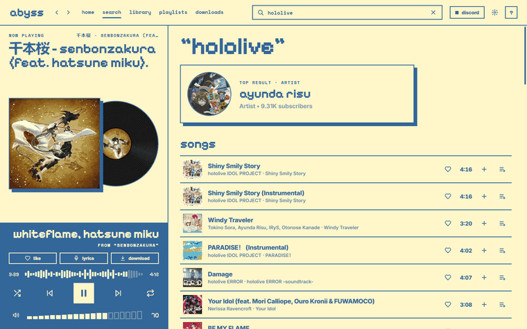
</div>

## Features

| | |
|---|---|
| 🎵 **Everything on YouTube Music** | Search, artists, albums, playlists, moods & genres, charts, radio, up next |
| 🈂️ **Lyrics** | Line-synced lyrics from LRCLIB, BetterLyrics, Unison, lrc.red, KuGou and YouTube Music, with a focus mode and text size controls |
| 🔤 **Romaji & translation** | 千本桜 → *senbon sakura*. Japanese, Korean, Chinese and Cyrillic, plus translation into 8 languages |
| 👤 **Your library** | Sign in with a code at google.com/device. Abyss never sees your password |
| 🎧 **Only music** | Playlists hide videos that aren't music (tutorials, vlogs…) and tell you how many |
| ⬇️ **Downloads** | Songs, albums or whole playlists, with a live progress panel |
| 🎨 **Themes & fonts** | White, dark, cream & blue, vice sunset, latte, sakura, or your own colors. Any font with any theme |
| 📻 **Mini player** | Winamp / AIMP style, a skin for every theme, always on top. <kbd>ctrl</kbd>+<kbd>m</kbd> |
| 🌊 **Smooth transitions** | Crossfade 2 to 12 s between songs, plus playback speed |
| 💬 **Discord** | Shows *Listening to abyss* with the song, cover and time |
| 🔄 **Updates itself** | New versions are found, checked (SHA-256) and installed for you |
| 📣 **Announcements** | News from the team shows up inside the app |
| 🛡️ **No ads** | Uses YouTube's official player. Never runs ads of its own |

## Screenshots

<table>
<tr>
<td width="50%">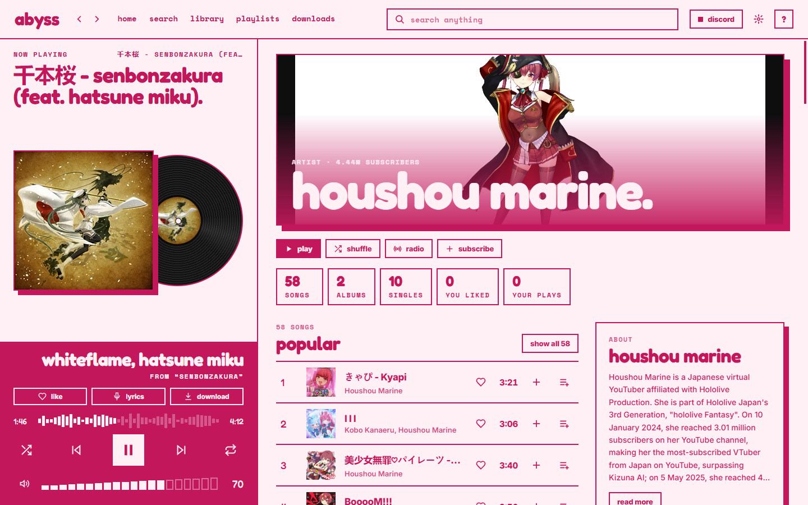<br><sub><b>Artist</b>: Houshou Marine · sakura</sub></td>
<td width="50%">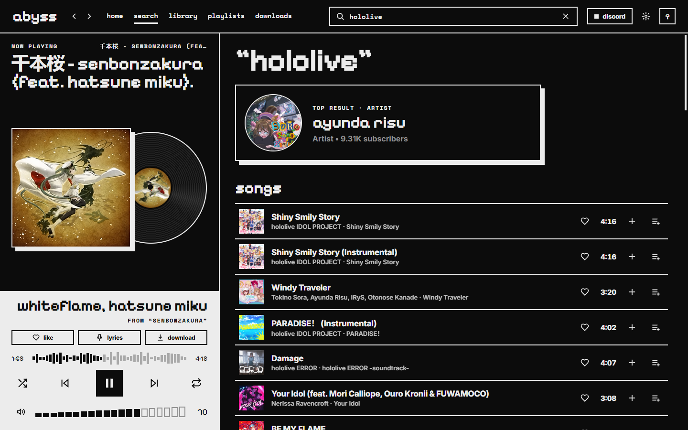<br><sub><b>Search</b>: “hololive” · dark</sub></td>
</tr>
<tr>
<td>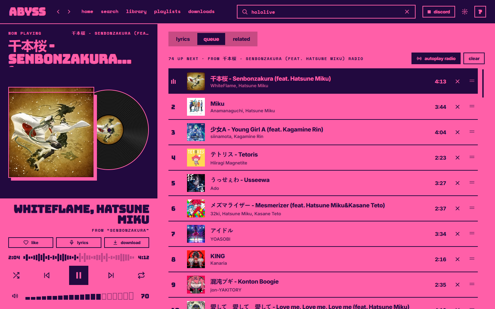<br><sub><b>Radio queue</b>: Vocaloid mix · vice sunset</sub></td>
<td>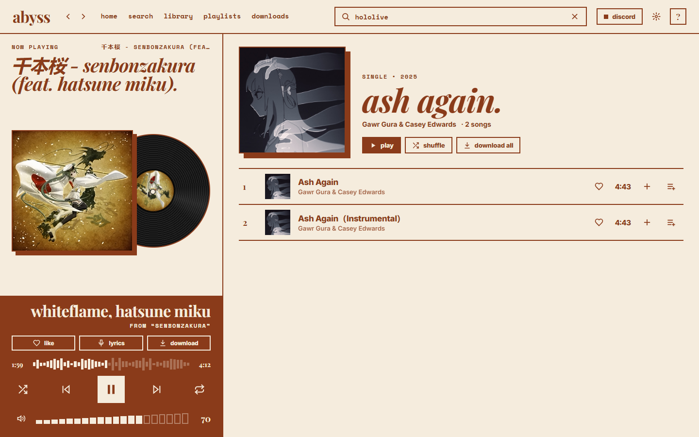<br><sub><b>Album</b>: Gawr Gura · latte</sub></td>
</tr>
</table>

<details open>
<summary><b>Mini player</b>: old-school skins, one per theme (<kbd>ctrl</kbd>+<kbd>m</kbd>)</summary>
<br>
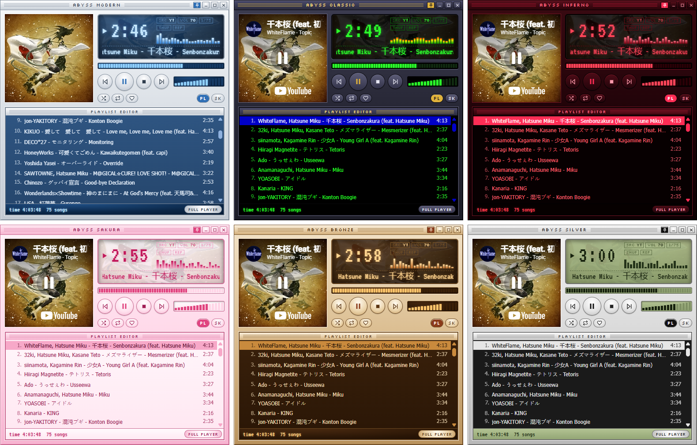
</details>

<details>
<summary><b>Themes</b> (7, including your own colors)</summary>
<br>
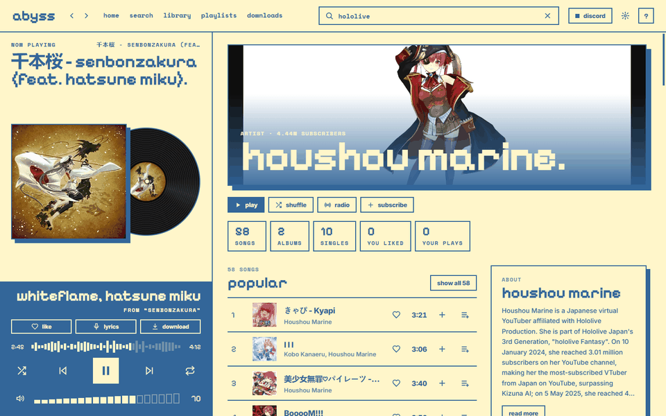
</details>

<details>
<summary><b>Fonts</b> (pixel, bungee, playfair, fredoka, orbitron, terminal, mono, anton, clean)</summary>
<br>
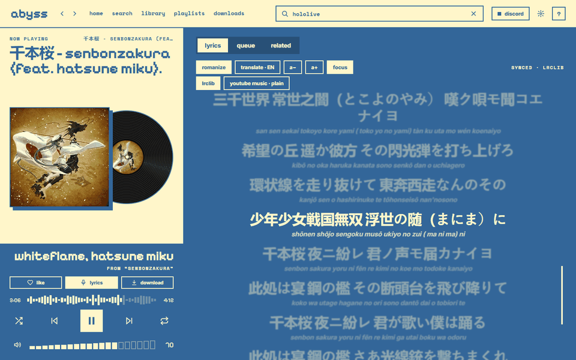
</details>

<details>
<summary><b>Settings</b></summary>
<br>
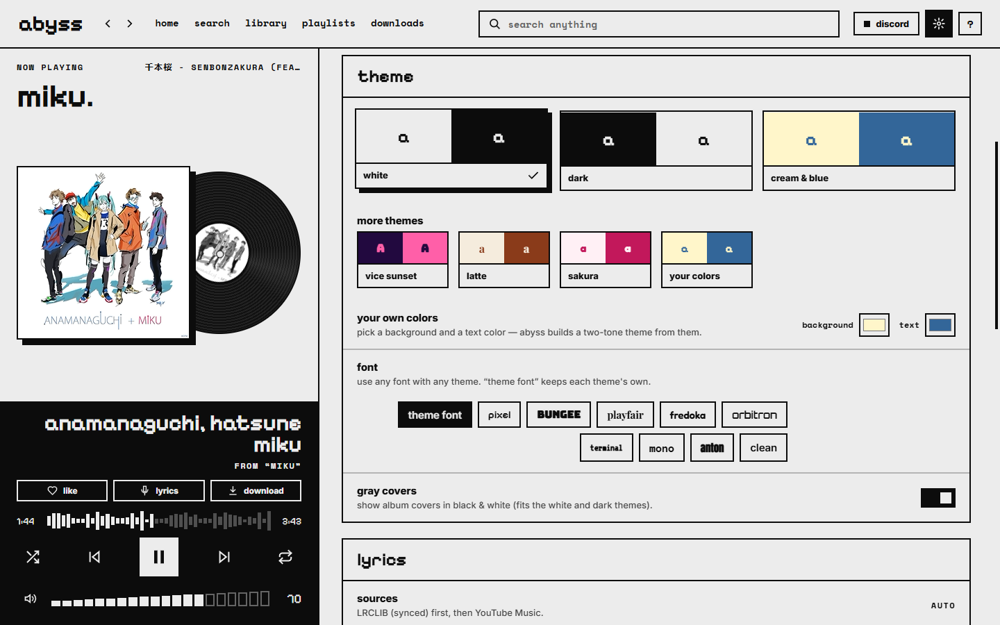
</details>

## Install

Every download is on the **[releases page](https://github.com/yumekuse/Abyss-Music/releases/latest)**.

### Windows 10 / 11

1. Download **`abyss-setup-<version>.exe`** and run it. No admin rights are needed.
2. If Windows shows *“Windows protected your PC”*, click **More info → Run anyway**. The app isn't code-signed yet.
3. Done. abyss updates itself from now on.

Prefer no installer? Grab **`abyss-<version>-windows-x64-portable.zip`**, unzip it and run `abyss.exe`.

### Linux

abyss uses your system's **WebKitGTK** and **GStreamer** codecs to run the YouTube player. Install them first, then pick your distro.

<details open>
<summary><b>Arch · CachyOS · EndeavourOS · Manjaro</b></summary>

```bash
sudo pacman -S --needed webkit2gtk-4.1 gst-plugins-good gst-plugins-bad gst-libav
# download PKGBUILD from the latest release, then in the same folder:
makepkg -si
```
</details>

<details>
<summary><b>Debian · Ubuntu · Kali · Linux Mint · Pop!_OS</b></summary>

```bash
sudo apt install ./abyss-music_<version>_amd64.deb   # pulls in WebKitGTK + GStreamer by itself
```
Needs Ubuntu 22.04+ / Debian 12+ (or any current Kali rolling).
</details>

<details>
<summary><b>Fedora · openSUSE · any other distro (tarball)</b></summary>

```bash
# Fedora:   sudo dnf install webkit2gtk4.1 gstreamer1-plugins-good gstreamer1-plugins-bad-free gstreamer1-libav
# openSUSE: sudo zypper install libwebkit2gtk-4_1-0 gstreamer-plugins-good gstreamer-plugins-bad gstreamer-plugins-libav
tar xzf abyss-<version>-linux-x86_64.tar.gz
cd abyss-<version>-linux-x86_64
./install.sh            # just for you (~/.local)   ·   sudo ./install.sh  for everyone
./install.sh --uninstall
```
</details>

<details>
<summary><b>AppImage</b> (updates itself)</summary>

```bash
chmod +x abyss-<version>-x86_64.AppImage
./abyss-<version>-x86_64.AppImage
```
The AppImage uses the WebKitGTK installed on your system (see the package names above).
</details>

## Using abyss

- **Sign in** (optional): click *sign in with google* → *sign in with a code*, open `google.com/device` in your browser, type the code, press Allow. abyss finishes by itself.
- **Romaji**: open a Japanese song → *lyrics* → *romanize*. Try 千本桜, アイドル or any hololive song.

| key | does |
|---|---|
| <kbd>space</kbd> | play / pause |
| <kbd>←</kbd> <kbd>→</kbd> | seek |
| <kbd>↑</kbd> <kbd>↓</kbd> | volume |
| <kbd>m</kbd> | mute |
| <kbd>l</kbd> | lyrics |
| <kbd>t</kbd> | next theme |
| <kbd>ctrl</kbd> + <kbd>f</kbd> | search |
| <kbd>ctrl</kbd> + <kbd>m</kbd> | mini player ↔ full player |

## Updates & announcements

abyss checks this repository a few seconds after it starts and every few hours after that.

- **New release** → a banner shows *“abyss x.y.z is here”* with **update now** and **what's new**. Windows and the AppImage download the update, check its SHA-256, install it and reopen by themselves. The .deb, AUR and tarball get a link to the new version.
- **Announcements** → anything in [`announcements.json`](announcements.json) shows up as a banner. People can dismiss it, and dismissed ones don't come back.

<details>
<summary><b>For maintainers: posting an announcement</b></summary>

Edit `announcements.json` on `main` and push. Every running app shows it within 3 hours (or right away after *settings → check for updates*).

```json
{
  "announcements": [
    {
      "id": "vocaloid-week-2026",
      "level": "important",
      "title": "vocaloid week ♪",
      "body": "new hatsune miku and kasane teto mixes are on home.\nhave fun!",
      "link": { "label": "see the mixes", "url": "https://github.com/yumekuse/Abyss-Music" },
      "date": "2026-12-01",
      "start": "2026-12-01",
      "end": "2026-12-08",
      "platforms": ["windows", "linux"],
      "minVersion": "0.2.0"
    }
  ]
}
```

| field | |
|---|---|
| `id` | **required**, unique. Change it to show an announcement again |
| `title`, `body` | text (`\n` for a new line). HTML isn't rendered |
| `level` | `info` · `update` · `warning` · `important` |
| `link` | optional button; `https://` links only |
| `start`, `end` | `YYYY-MM-DD`, shown only between these days |
| `minVersion`, `maxVersion` | only for these app versions |
| `platforms` | `windows`, `linux` |
| `dismissible` | `false` keeps it on screen |
</details>

<details>
<summary><b>For maintainers: releasing a new version</b></summary>

1. Bump `version` in `Cargo.toml` and add a `## <version>` section to [`CHANGELOG.md`](CHANGELOG.md). That section becomes the in-app *what's new*.
2. Commit, then tag and push:
   ```bash
   git tag v0.3.0 && git push origin v0.3.0
   ```
3. GitHub Actions builds the Windows installer and portable zip, plus the Linux `.deb`, tarball, AppImage and PKGBUILD, and publishes the release. Every abyss out there then offers the update.
</details>

## Build from source

```bash
git clone https://github.com/yumekuse/Abyss-Music && cd Abyss-Music
cargo build --release        # → target/release/abyss(.exe)
```
- **Windows:** Rust (MSVC toolchain). `powershell -File installer\build.ps1` also builds the installer with [Inno Setup 6](https://jrsoftware.org/isinfo.php).
- **Linux:** Rust plus `libwebkit2gtk-4.1-dev libgtk-3-dev libsoup-3.0-dev pkg-config` (Debian names), or `webkit2gtk-4.1 base-devel` (Arch).

<details>
<summary>How it's put together</summary>

| | |
|---|---|
| `src/main.rs` | window ([tao](https://github.com/tauri-apps/tao) + [wry](https://github.com/tauri-apps/wry)), single instance, close handling |
| `src/server.rs` | local server for the UI, request guard, font cache |
| `src/yt.rs` | YouTube Music over InnerTube: home, search, artists, albums, playlists, library, music-only filter, downloads |
| `src/auth.rs` | Google device-code sign-in; credentials encrypted with DPAPI on Windows, `0600` file on Linux |
| `src/lyrics.rs` · `src/romanize.rs` | six lyrics sources in parallel; romaji / pinyin / Revised Romanization |
| `src/update.rs` | auto-update + announcements |
| `src/dl.rs` | download queue with progress |
| `src/discord.rs` | Discord Rich Presence |
| `ui/` | the interface (plain HTML / CSS / JS) |
</details>

## FAQ

<details>
<summary><b>Where is my data?</b></summary>

Settings, likes, queue and downloads live in `%APPDATA%\abyss` (Windows) or `~/.config/abyss` (Linux). Caches live in `%LOCALAPPDATA%\abyss` or `~/.cache/abyss`. Nothing leaves your PC except requests to YouTube, the lyrics sites and GitHub (for updates).
</details>

<details>
<summary><b>Linux: the window is blank or the player won't play</b></summary>

- Install the GStreamer codecs listed under [Linux](#linux) (`gst-libav` / `gstreamer1.0-libav` especially).
- abyss sets `WEBKIT_DISABLE_DMABUF_RENDERER=1` by default to avoid blank windows on some GPUs. Start it with `WEBKIT_DISABLE_DMABUF_RENDERER=0 abyss` to opt out.
</details>

<details>
<summary><b>Will I get ads?</b></summary>

abyss uses YouTube's official embedded player, so YouTube decides. Without YouTube Premium you may occasionally see one. abyss never adds its own.
</details>

<details>
<summary><b>Is this affiliated with YouTube or Google?</b></summary>

No. abyss is an independent open-source project. YouTube and YouTube Music are trademarks of Google LLC. Songs, covers and artist art belong to their owners. The screenshots show public YouTube Music pages.
</details>

## Contributing

Bug reports and ideas are welcome in **[issues](https://github.com/yumekuse/Abyss-Music/issues)**. When you report a bug, say what you clicked and what happened (a screenshot helps), and attach `abyss.log` from the data folder above.

<div align="center">
<sub>MIT licensed · made with ♪ and a lot of Vocaloid</sub>
</div>
